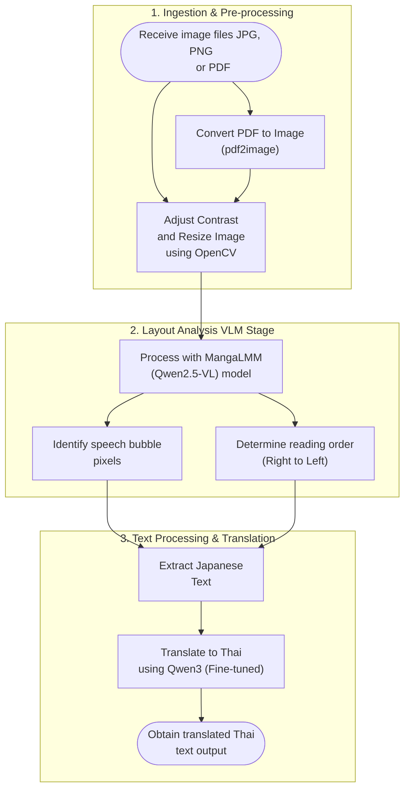

## 4.2 Data Pipeline Design

The project's Data Pipeline is divided into 3 main phases to ensure data is ready for processing:

1. **Ingestion & Pre-processing**: Receives image files (JPG/PNG) or PDFs (via `pdf2image`), then uses OpenCV to adjust contrast and resize the image to fit the input requirements of MangaLMM.

2. **Layout Analysis (VLM Stage)**: Uses the MangaLMM (Qwen2.5-VL) model to detect the pixels of speech bubbles and determine the reading order from right to left.

3. **Text Processing & Translation**: Extracts the Japanese text and forwards it to the fine-tuned Qwen3 model to translate it into Thai.

