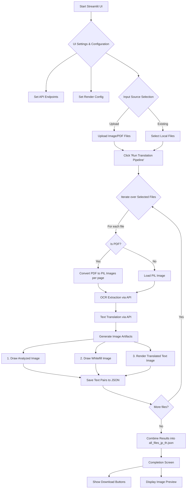

# Streamlit App Execution Flow

Here is the step-by-step execution flow of the `streamlit_app.py` Streamlit application, broken down into its logical pipeline stages:

### 1. UI Initialization & Configuration

- **Page Setup**: The application configures a wide-layout Streamlit page titled "Manga Translator UI".
- **Sidebar Settings**: Gathers essential execution configurations from the user:
  - **API Endpoints**: URLs for the OCR service and Translation service (either via a base URL + paths, or direct full URLs).
  - **Rendering Config**: Font path (defaulting to a Thai font), box padding around text bubbles, and timeout/quality/retry controls for network requests.
- **Input Source Selection**: Gives the user two modes for providing files:
  - **Upload Mode**: Upload `.png`, `.jpg`, `.jpeg`, or `.pdf` files which are saved to a temporary directory.
  - **Existing Files**: Analyzes a specified directory (defaulting to `images/`), allowing the user to multi-select existing local files.

### 2. Pipeline Trigger & Validation

- When the user clicks **"Run Translation Pipeline"**, the script validates that files are selected and both the OCR and Translation API URLs are populated.
- It initializes a progress bar and empty status text to track the batch process.
- Iterates through the list of collected `selected_paths`, passing each file into the core `process_single_file()` function.

### 3. File Processing (`process_single_file`)

For each image or PDF, the application executes the following sequence:

- **PDF Conversion (Optional)**: If the file is a `.pdf`, it uses `pdf2image` and Poppler to convert it into a list of PIL Images (treating each page as a separate unit). Standard images just load directly into memory.
- **OCR Extraction (`run_ocr_for_pil_image`)**:
  - Compresses the image into memory as a JPEG.
  - Sends the image to the remote OCR API.
  - Receives JSON containing the `ocr_blocks` (which includes bounding boxes/quad polygons and the original Japanese text).
- **Text Translation (`run_translation`)**:
  - Collects all extracted Japanese sentences.
  - Iterates through them, calling the Translation API one-by-one to get the corresponding translated (Thai) text.
- **Image Artifact Generation**:
  - **Analyzed Image (`draw_ocr_boxes`)**: Draws red bounding boxes and numerical index labels over the original image to show where text was detected. Saves it as an `_analyzed.jpg` artifact.
  - **Whitefill Image (`fill_boxes_with_white`)**: Erases the original Japanese text by filling the detected text box regions with a background color. Saves it as a `_whitefill.jpg` artifact.
  - **Rendered Final Image (`draw_translated_text_in_boxes`)**:
    1. Uses a luminosity check (`is_dark_box`) to decide whether to paint white text on a black background or black text on a white background.
    2. Dynamically calculates the best font size that fits inside the box and wraps the sentences at word boundaries (`fit_and_wrap_text`).
    3. Perfectly aligns and centers the new translated text within the masked bubble spaces (`draw_scaled_text_line`).
    4. Saves the resulting visual translation as a `_translated.jpg` artifact.
- **Metadata Save**: Captures the text pairs (File/Page, Japanese text, and Translated text) and writes them to a specific `<filename>_jp_th.json`.

### 4. Aggregation & UI Delivery

- **Combine Results**: After the loop finishes, the script joins all the text pairs across all processed files into a single `all_files_jp_th.json` dictionary.
- **Completion Screen**:
  - The progress bar bumps to 100%.
  - Presents **Download Buttons** giving the user access to download the combined JSON payload, as well as the individual JSON chunks.
  - Displays a visual **Preview** inline in Streamlit containing up to the first 10 rendered translated images.
  - Reports the output summaries confirming the saved debug images (`analyzed` and `whitefill`).

---

### Mermaid Pipeline Flow Diagram

