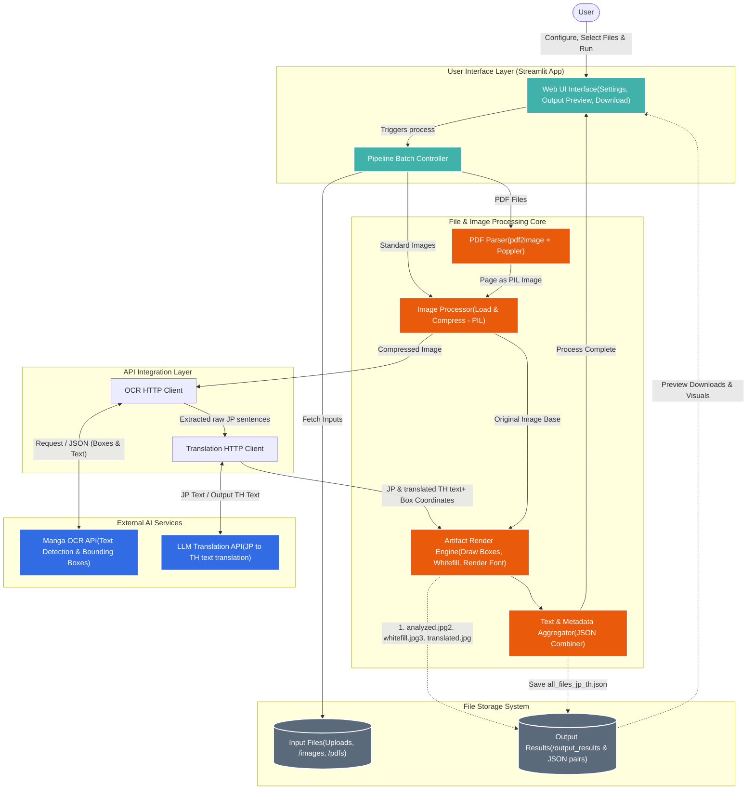

# Manga Translator System Architecture

This document describes the high-level architecture of the Manga Translator application. It breaks down the system into the user interface, core processing elements, external AI services, and file storage components.

## Key Architectural Layers

1. **User Interface Layer**: Powered by `streamlit_app.py`, providing user controls for API configuration, file uploading (`.pdf`, `.jpg`, `.png`), and displaying interactive outputs.
2. **File & Image Processing Core**: A local engine managing file formatting (`poppler`/`pdf2image`, `PIL`), background clearing (whitefill), and calculating/drawing localized text boxes.
3. **API Integration Layer**: HTTP clients connecting the Streamlit frontend with remote AI services.
4. **External AI Services**: Independent REST endpoints handling the heavy lifting: Manga OCR API for text detection and LLM Translation API for Japanese-to-Thai translation.
5. **Storage System**: Reads input files from specified directories or temp uploads and writes results (debug images, final translated images, and JSON data) to the `output_results/` directory.
